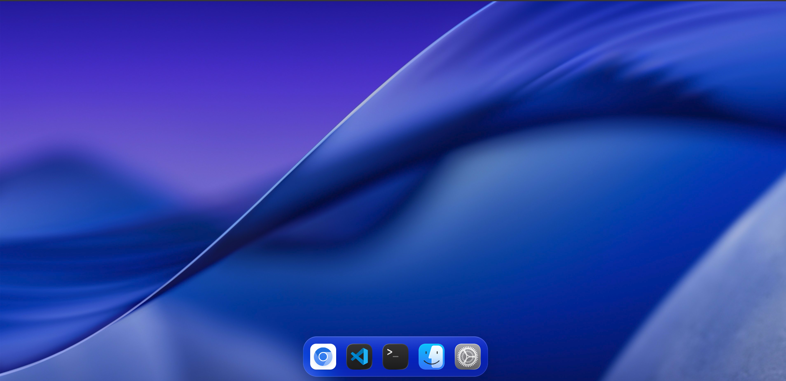
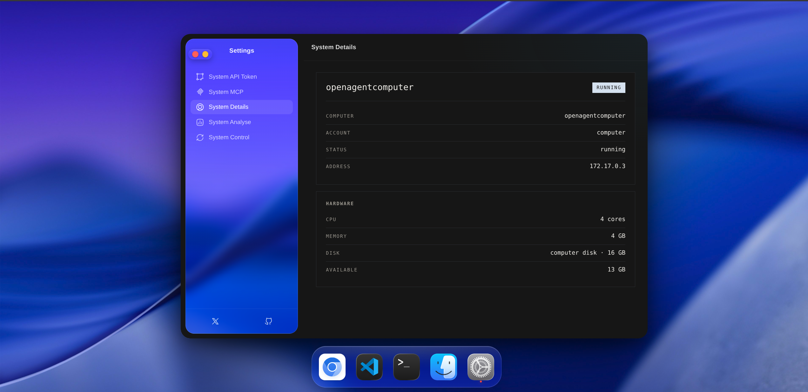
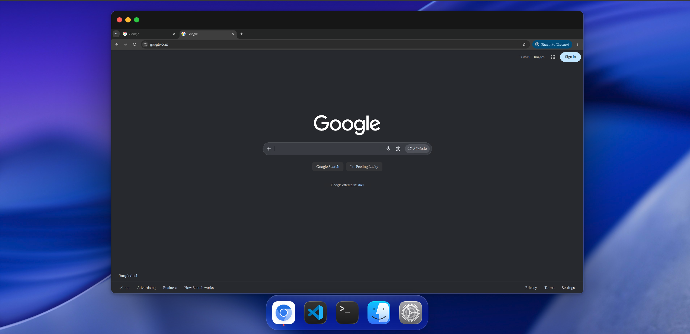
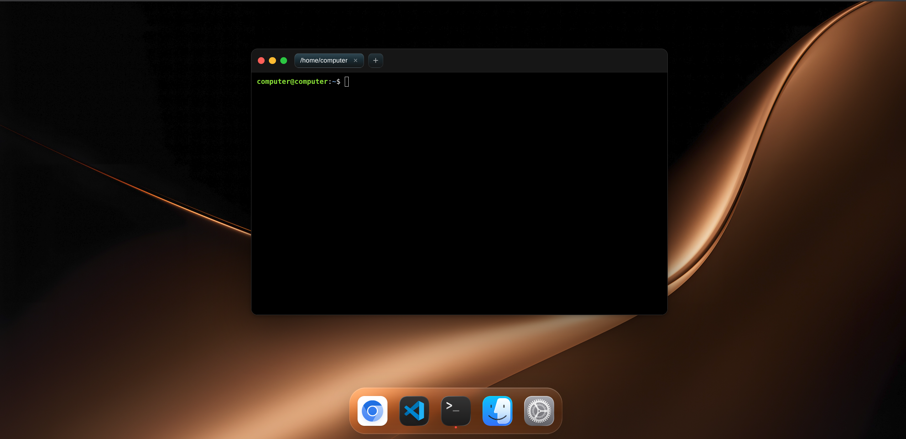

# OpenHumenComputer

**One click. Many AI agents. One real Linux computer.**
No expensive cloud VPS per agent, no staring at a terminal, no giving your own laptop to an AI.

[](https://youtu.be/fhSloyFmxl8)

▶ **[Watch the demo on YouTube](https://youtu.be/fhSloyFmxl8)**

*The demo shows the desktop, the terminal with a local model and a coding agent, VS Code, and the settings — all inside the computer.*

---

## Why this exists

Every serious AI agent needs a computer: a shell, files, a browser, an editor, a place to install things and break things. Buying a separate cloud VPS for every agent is expensive, and sitting in front of a terminal for each one is tiring.

OpenHumenComputer is one platform for all of them. Install it with one command, connect the AI harnesses you already use (Claude, Codex, Cline, Kilo, or your own) through an API token or MCP, and let them work inside a real Linux computer — while you keep your own laptop, and your laptop stays untouched.

## Overview

OpenAgentHumenComputer is an isolated virtual operating system built for AI agents and humans to work together. It turns any ordinary host machine, server, or resource-limited environment into a complete, safe Linux workspace in minutes.

The AI harnesses run inside a strictly controlled sandbox where they can code, run shell commands, install packages and touch files without putting the host at risk. You can watch the same desktop they work on, step in when needed, and use it yourself.

## Key capabilities

- **Rootless host, root inside.** On a server where you have no `sudo`, OpenHumenComputer starts an Ubuntu container where the agent — and you — have full root.
- **One platform, many agents.** Several harnesses can attach to the same computer through the API and MCP; each works on its own task while you manage them from one place.
- **Local Docker, your hardware.** The platform is built for the Docker engine you already run, on the machine you already own. You choose the cores, the RAM and the storage; nothing is rented per agent.
- **Cross-device access.** The desktop is streamed with noVNC; the browser is driven over the Chrome DevTools Protocol; the machine is reachable over MCP. A desktop, a phone or a small device is enough to watch and control it.
- **A real desktop, not a terminal.** Chrome, a terminal with real PTY tabs, a file manager with upload, a text editor, a media viewer and VS Code Server — all inside the computer.
- **Full package freedom.** `sudo apt install`, `dpkg -i` and any `.deb` application work, because it is a real Ubuntu.
- **Skills you keep.** Bring your own skills folder into the computer; the agent reads it from the filesystem, and the skills stay with the computer, not with a vendor.
- **Built for security work.** A separate machine for pentesting, network diagnostics, scripting or malware-adjacent experiments, isolated from everything you care about.
- **Honest provisioning.** Watch every step being built with live logs and a progress bar; when it fails, it says why.

## Architecture and security

```
browser ──► bridge (one process on :1010)
              /            the desktop
              /api/*       create, files, token, services
              /ws/pty      a real terminal inside the computer
              /ws/cdp      the DevTools socket of its Chrome
              /websockify  the live picture of its screen
              /novnc/*     the noVNC client
                    │
                    ▼
             docker socket
                    ▼
      computer container (Ubuntu 24.04)
      Xvfb · x11vnc · noVNC · Chrome + CDP
      xterm · PCManFM · VS Code Server · MCP
      an account with a password and passwordless sudo
```

- **Docker isolation** — every operation, script and system change stays inside the container. A mistake costs a container, never the host.
- **MCP and API** — a token-authenticated API (`/api/exec`, `/api/file`, `/api/upload`, `/api/screenshot`, `/api/desktop`, `/api/open-url`) and an MCP server expose the computer's terminal, files, browser and desktop as tools.
- **No host data** — no host directory is mounted into the computer by default; the repository carries no user data.
- **One origin** — the bridge serves the UI, the API and every stream from one port, so there is no fragile proxy between the browser and the machine.

## Provisioning workflow

1. **Configure** — the computer's name, the account, the password, the country, the language and the time zone. (Dynamic support for every time zone is on the way.)
2. **Allocate** — the CPU cores, the RAM, the storage volume and the GPU share, as the job needs.
3. **Initialize** — press CREATE and watch the image being built and the container being started, step by step. The first build takes 15–25 minutes (curl and Python are compiled from source, Chrome and VS Code are downloaded); later computers start in seconds.
4. **Use it** — the page moves to the live graphical desktop as soon as the computer is up.

## The one command

```bash
curl -fsSL https://raw.githubusercontent.com/nextceo-yeasinarafat/OpenAgentHumenComputer/main/docker/script/setup.sh | bash
```

It installs Docker when it is missing, clones this repository, builds the UI image, starts it on port `1010` with the Docker socket mounted, and opens the page. From there, CREATE makes the computer.

Requirements: Docker, `git`, `curl`, network, about 5 GB of free disk.

## Screens

**The desktop** — a real Linux desktop in the browser; the dock holds the computer's applications.


**Settings → System Details** — the computer, its account and the hardware that was chosen.



**Chrome** — the computer's own browser, painted from its screen and driven through the DevTools protocol.



**Terminal** — a real PTY inside the computer, opening in the computer user's home.



## Limits, stated honestly

- The first image build is long; later builds reuse it.
- One computer per host in this version; cloud VPS integration with advanced isolation is in progress.
- Storage quotas are requested from the Docker driver and are best-effort.
- Snapshots, clones and team sharing are not in this version.
- Docker itself may need admin rights once to install; after that, the computer has its own root and needs nothing from the host.

## Repository

| Path | What lives there |
| --- | --- |
| `core/apps/` | the desktop: layout, dock, Chrome, terminal, explorer, editor, media viewer, settings |
| `core/server/bridge.py` | the single server: UI, API, PTY, CDP, screen, files, token, services |
| `docker/system/` | the computer: screen, browser, terminal, explorer, VS Code, MCP, fonts |
| `docker/ubuntu/` | the Ubuntu image the computer is built from |
| `docker/ui/` | the UI image and its one-command entrypoint |
| `docker/script/setup.sh` | the short command above |
| `public/` | wallpaper, icons, screenshots |
| `devpost/` | `scope.md`, `prd.md`, `spec.md` |

## Documentation

- [`devpost/scope.md`](devpost/scope.md) — the problem, the kernel, what "done" means.
- [`devpost/prd.md`](devpost/prd.md) — the product as a person experiences it.
- [`devpost/spec.md`](devpost/spec.md) — how it is built, how it fails, how it recovers.

## License

MIT — see [`LICENSE`](LICENSE).

## Name

The product is **OpenHumenComputer**. The repository is **OpenAgentHumenComputer**; the computer container is `openagentcomputer`, the UI container `openagenthumencomputer`.
